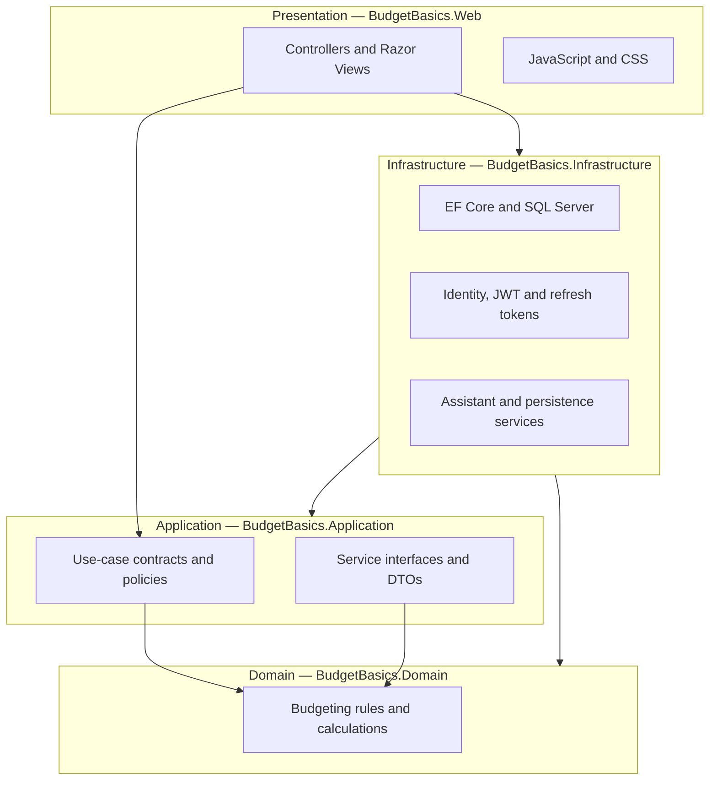
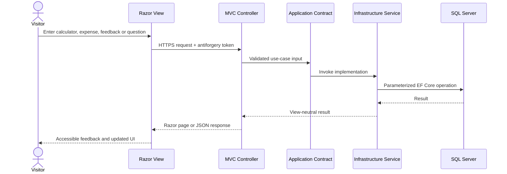
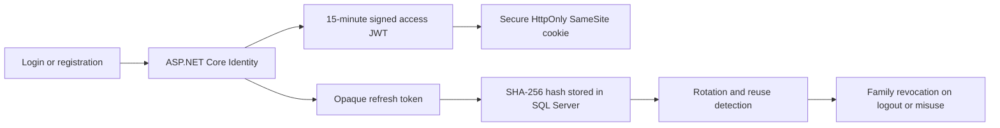
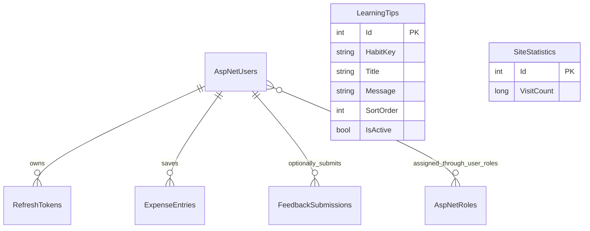
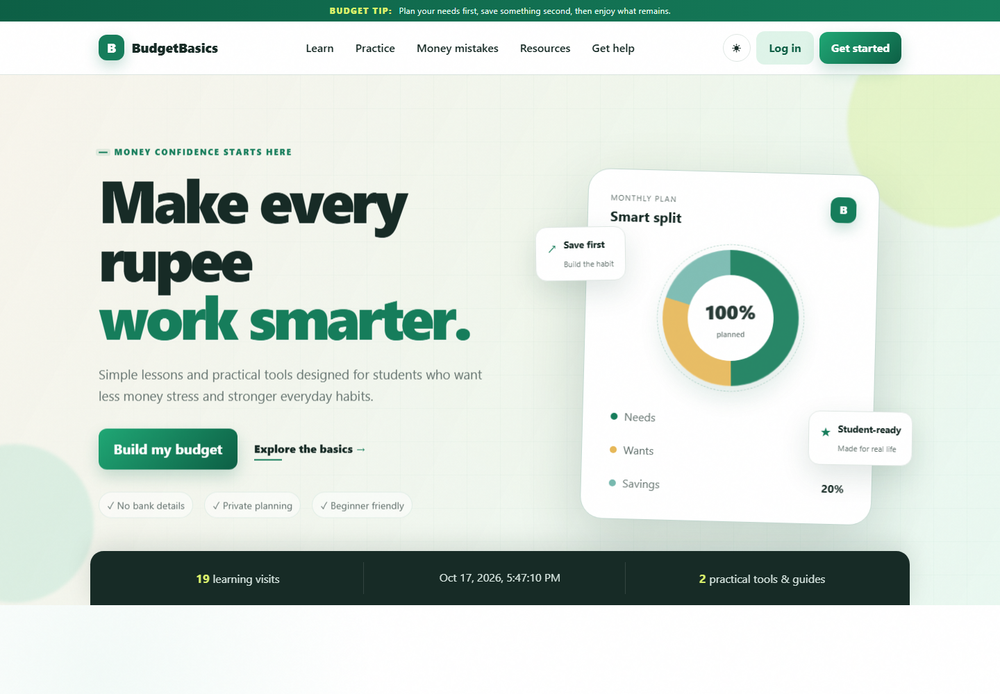
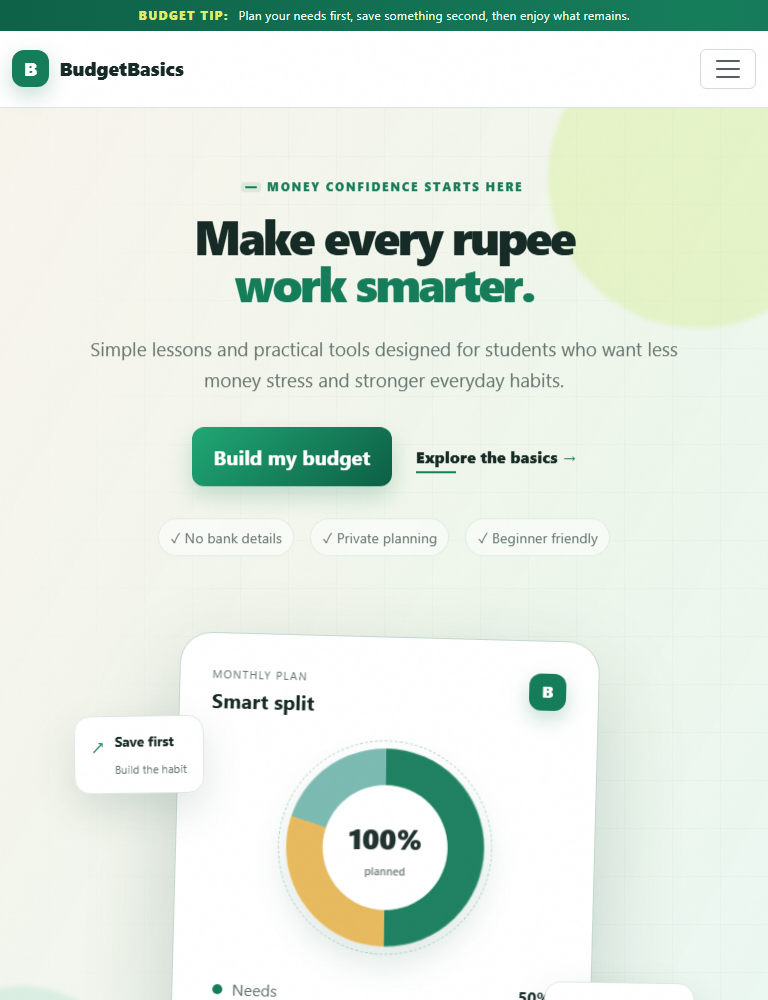
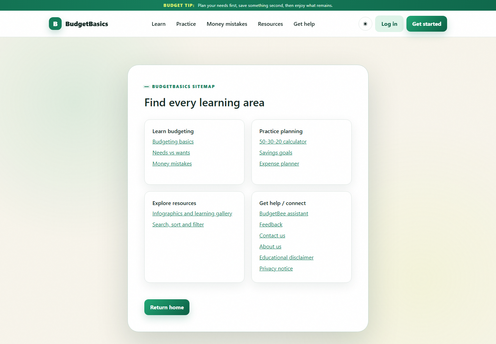
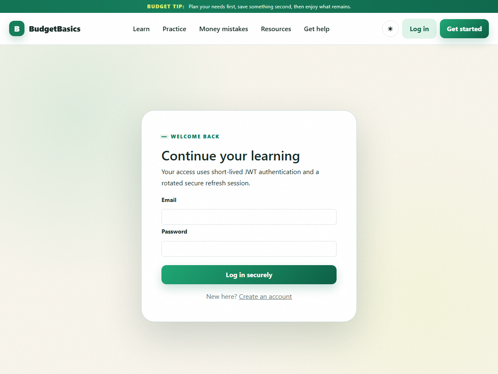

# BudgetBasics — Make Every Rupee Work Smarter

> A secure, student-focused financial education platform that turns budgeting concepts into interactive calculators, practical planning tools, curated guidance, and beginner-friendly assistance.

[](https://dotnet.microsoft.com/)
[](https://learn.microsoft.com/aspnet/core/mvc/)
[](https://learn.microsoft.com/ef/core/)
[](https://github.com/sobhanabdullah30-a11y/Budget-Basics/actions/workflows/ci.yml)
[](https://github.com/sobhanabdullah30-a11y/Budget-Basics/actions/workflows/codeql.yml)
[](https://budgetbasics-pk.runasp.net/)
[](./docs/SRS-TRACEABILITY.md)

**Live application:** [https://budgetbasics-pk.runasp.net](https://budgetbasics-pk.runasp.net)

BudgetBasics is built with ASP.NET Core MVC, Razor Views, SQL Server, Entity Framework Core, ASP.NET Core Identity, and secure JWT sessions. Its Onion Architecture keeps business rules independent from UI, database, and hosting concerns.

## Table of contents

- [Source code](#source-code)
- [Architecture](#architecture)
- [Screenshots](#screenshots)
- [Features](#features)
- [Technology stack](#technology-stack)
- [Setup and installation](#setup-and-installation)
- [Database migrations and preseeded data](#database-migrations-and-preseeded-data)
- [Testing and quality](#testing-and-quality)
- [CI/CD and version control](#cicd-and-version-control)
- [Deployment guide — MonsterASP.NET](#deployment-guide--monsteraspnet)
- [Caching and CDN](#caching-and-cdn)
- [Animations and special effects](#animations-and-special-effects)
- [Security and configuration](#security-and-configuration)

## Source code

The complete source is organized as a multi-project .NET solution:

| Component | Responsibility | Source |
|---|---|---|
| Domain | Budget allocation and savings-goal business rules | [`src/BudgetBasics.Domain`](./src/BudgetBasics.Domain) |
| Application | Use-case contracts, policies, DTOs, assistant and planning abstractions | [`src/BudgetBasics.Application`](./src/BudgetBasics.Application) |
| Infrastructure | SQL Server, EF Core, Identity, JWT, refresh tokens and service implementations | [`src/BudgetBasics.Infrastructure`](./src/BudgetBasics.Infrastructure) |
| Web | MVC controllers, Razor Views, view models, JavaScript and CSS | [`src/BudgetBasics.Web`](./src/BudgetBasics.Web) |
| Domain tests | Pure business-rule tests | [`tests/BudgetBasics.Domain.Tests`](./tests/BudgetBasics.Domain.Tests) |
| Integration tests | MVC, configuration, authentication and assistant tests | [`tests/BudgetBasics.IntegrationTests`](./tests/BudgetBasics.IntegrationTests) |

- Open the solution: [`BudgetBasics.slnx`](./BudgetBasics.slnx)
- Review SRS coverage: [`docs/SRS-TRACEABILITY.md`](./docs/SRS-TRACEABILITY.md)
- Read the detailed architecture notes: [`docs/ARCHITECTURE.md`](./docs/ARCHITECTURE.md)

```text
Budget-Basics/
├── src/
│   ├── BudgetBasics.Domain/
│   ├── BudgetBasics.Application/
│   ├── BudgetBasics.Infrastructure/
│   └── BudgetBasics.Web/
├── tests/
│   ├── BudgetBasics.Domain.Tests/
│   └── BudgetBasics.IntegrationTests/
├── docs/
├── BudgetBasics.slnx
├── Directory.Build.props
└── dotnet-tools.json
```

**Public repository:** [github.com/sobhanabdullah30-a11y/Budget-Basics](https://github.com/sobhanabdullah30-a11y/Budget-Basics)

## Architecture

### Onion Architecture and dependency direction



The Domain layer has no dependency on MVC, EF Core, SQL Server, or hosting. Infrastructure implements interfaces owned by the Application layer, while Web acts as the composition root.

### Request and persistence flow



### Authentication flow



Raw tokens are never stored in the database or browser storage. Unsafe form requests are protected with ASP.NET Core antiforgery validation.

### Core data model



## Screenshots

### Desktop landing experience



### Responsive layout

<p align="center">
  
</p>

Both screenshots were captured from the live MonsterASP.NET deployment.

### Navigation and secure authentication

<p align="center">
  
  
</p>

## Features

### Financial learning

- Beginner-friendly explanations of income, fixed expenses, variable expenses and savings.
- Student budget example using PKR and the 50/30/20 guideline.
- Six-question Needs vs Wants activity with immediate explanations and a final score.
- Five expandable real-life money-mistake scenarios and corrective actions.
- Four responsive visual learning graphics with search, topic filters and sorting.
- SQL-backed student tips for food, transport, impulse spending, subscriptions and saving.

### Planning tools

- **50/30/20 calculator** with validated decimal calculations and educational disclaimer.
- **Savings-goal estimator** with remaining amount, progress and estimated completion time.
- **Expense planner** with seven categories, editing, deletion, totals and remaining balance.
- Temporary guest planning plus secure SQL persistence for authenticated learners.
- Database-backed aggregate visitor counter and live localized date/time.

### BudgetBee assistant

- Beginner-friendly budgeting Q&A with suggested prompts.
- Server-side rate limiting and strict input validation.
- Curated rule-based fallback when an external assistant is unavailable.
- Clear out-of-scope response and educational-not-financial-advice notice.
- No external provider branding is exposed in the frontend.

### Accounts and platform security

- Learner registration, login, profile and logout.
- ASP.NET Core Identity password hashing, unique email rules and account lockout.
- Signed JWT access tokens with issuer, audience, lifetime and signature validation.
- Rotating refresh tokens with token-family reuse detection and revocation.
- Secure, HttpOnly, SameSite cookies; no JWT storage in `localStorage`.
- Antiforgery protection, HTTPS/HSTS, CSP, frame protection and secure response headers.

### User experience

- Responsive desktop, tablet and mobile layout.
- Dark/light theme with locally stored preference.
- Keyboard navigation, skip link, focus styles and ARIA live regions.
- Reduced-motion support through `prefers-reduced-motion`.
- About, contact, feedback, privacy, disclaimer and sitemap pages.

## Technology stack

| Area | Technology |
|---|---|
| Framework | .NET 10 and ASP.NET Core MVC |
| Frontend | Razor Views, HTML5, CSS3, Bootstrap 5 and vanilla JavaScript |
| Database | Microsoft SQL Server |
| Data access | Entity Framework Core 10 with migrations |
| Authentication | ASP.NET Core Identity, JWT Bearer and rotating refresh tokens |
| Architecture | Onion Architecture with dependency inversion |
| Testing | xUnit and `Microsoft.AspNetCore.Mvc.Testing` |
| Hosting | MonsterASP.NET shared IIS hosting with HTTPS and SQL Server |
| Quality | Nullable reference types, warnings-as-errors and Lighthouse |

## Setup and installation

### Prerequisites

- [Visual Studio](https://visualstudio.microsoft.com/) with **ASP.NET and web development** and **Data storage and processing** workloads, or the .NET 10 SDK.
- SQL Server LocalDB for the default development connection, or another SQL Server instance.
- Git for source control.

### 1. Get the project

After publishing this directory to GitHub:

```powershell
git clone <your-repository-url>
Set-Location Budget-Basics
```

When working from the existing checkout, open [`BudgetBasics.slnx`](./BudgetBasics.slnx) directly.

### 2. Restore dependencies and local tools

```powershell
dotnet restore BudgetBasics.slnx
dotnet tool restore
```

### 3. Configure development secrets

Initialize user-secrets once and generate a strong local JWT signing key:

```powershell
dotnet user-secrets init --project .\src\BudgetBasics.Web

$keyBytes = New-Object byte[] 64
$randomGenerator = [System.Security.Cryptography.RandomNumberGenerator]::Create()
$randomGenerator.GetBytes($keyBytes)
$randomGenerator.Dispose()
$jwtSigningKey = [Convert]::ToBase64String($keyBytes)

dotnet user-secrets set "Jwt:SigningKey" $jwtSigningKey --project .\src\BudgetBasics.Web
```

The repository's default development connection uses SQL Server LocalDB. To use another SQL Server instance:

```powershell
dotnet user-secrets set "ConnectionStrings:DefaultConnection" "Server=YOUR_SERVER;Database=BudgetBasicsDb;Trusted_Connection=True;TrustServerCertificate=True" --project .\src\BudgetBasics.Web
```

The enhanced assistant is optional because BudgetBee includes a local fallback:

```powershell
dotnet user-secrets set "Gemini:ApiKey" "YOUR_API_KEY" --project .\src\BudgetBasics.Web
```

Never commit passwords, API keys, connection strings, JWT keys, `.publishSettings`, `.pubxml.user`, or `.env` files.

### 4. Create/update the database

```powershell
dotnet tool run dotnet-ef database update `
  --project .\src\BudgetBasics.Infrastructure `
  --startup-project .\src\BudgetBasics.Web
```

Development and production startup also apply pending migrations when configured.

### 5. Run the application

#### Visual Studio

1. Open `BudgetBasics.slnx`.
2. Right-click **BudgetBasics.Web** and select **Set as Startup Project**.
3. Press `Ctrl+F5` or `F5`.

#### Command line

```powershell
dotnet run --project .\src\BudgetBasics.Web
```

Use the HTTPS URL shown in the terminal. Open `/health` to confirm the application is running.

## Database migrations and preseeded data

Create a migration after changing the EF Core model:

```powershell
dotnet tool run dotnet-ef migrations add DescriptiveMigrationName `
  --project .\src\BudgetBasics.Infrastructure `
  --startup-project .\src\BudgetBasics.Web `
  --output-dir Persistence\Migrations
```

Apply it locally:

```powershell
dotnet tool run dotnet-ef database update `
  --project .\src\BudgetBasics.Infrastructure `
  --startup-project .\src\BudgetBasics.Web
```

The included migrations create Identity, refresh-token, expense, feedback, visitor-statistic and learning-tip tables. `AddPreseededLearningTips` inserts 12 curated tips, so a new database has useful learning content immediately.

## Testing and quality

Run the complete verification suite:

```powershell
dotnet build BudgetBasics.slnx --no-restore
dotnet test .\tests\BudgetBasics.Domain.Tests\BudgetBasics.Domain.Tests.csproj --no-restore
dotnet test .\tests\BudgetBasics.IntegrationTests\BudgetBasics.IntegrationTests.csproj --no-restore
node --check .\src\BudgetBasics.Web\wwwroot\js\site.js
```

Current verified results:

| Check | Result |
|---|---:|
| Domain tests | 5 passed |
| Integration tests | 14 passed |
| Live health endpoint | HTTP 200 |
| Live calculator smoke tests | Passed |
| SQL-seeded tip endpoint | Passed |
| Live register/login/refresh/logout flow | Passed |
| Live SQL expense CRUD and persistence | Passed |
| Live feedback SQL write | Passed |
| Lighthouse Performance | 99 |
| Lighthouse Accessibility | 100 |
| Lighthouse Best Practices | 100 |
| Lighthouse SEO | 100 |

The final audit recorded a **1.7 s LCP**, **40 ms total blocking time**, and **0 cumulative layout shift**.

## CI/CD and version control

- `main` is the production branch and the source of deployable releases.
- GitHub Actions restores locked dependencies, builds with warnings as errors, executes all automated tests, collects coverage, and creates an IIS-ready artifact.
- CodeQL scans C# on pushes, pull requests, and a weekly schedule.
- Dependabot monitors NuGet packages and GitHub Actions.
- A production deployment can run only after CI succeeds, or through an authorized manual workflow dispatch.
- MonsterASP credentials are read from the protected `production` GitHub environment and are never committed.
- Each deployment ends with an HTTPS `/health` verification.
- A scheduled production monitor checks availability, database-backed reference data, and security headers every 30 minutes.

See the complete [production operations guide](./docs/OPERATIONS.md), including the one-time GitHub environment configuration.

## Deployment guide — MonsterASP.NET

### Live production environment

| Setting | Value |
|---|---|
| Website | [https://budgetbasics-pk.runasp.net](https://budgetbasics-pk.runasp.net) |
| Health check | [https://budgetbasics-pk.runasp.net/health](https://budgetbasics-pk.runasp.net/health) |
| Platform | MonsterASP.NET / IIS |
| Runtime | ASP.NET Core / .NET 10 |
| Database | MonsterASP Microsoft SQL Server |
| Transport | HTTPS with HSTS |

### Required production configuration

Create these values in the MonsterASP site environment/settings panel. Use double underscores for nested ASP.NET Core keys:

| Environment variable | Purpose |
|---|---|
| `ASPNETCORE_ENVIRONMENT=Production` | Enables production middleware and configuration |
| `ConnectionStrings__DefaultConnection` | Production SQL Server connection string |
| `Jwt__SigningKey` | Random signing secret of at least 64 characters |
| `Jwt__Issuer=BudgetBasics` | JWT issuer validation |
| `Jwt__Audience=BudgetBasics.Mvc` | JWT audience validation |
| `Database__ApplyMigrations=true` | Applies pending EF Core migrations |
| `Gemini__ApiKey` | Optional server-side assistant key |
| `Gemini__Enabled=true` | Enables the optional enhanced assistant |

Keep every secret in MonsterASP environment settings—never in `appsettings.json`, the publish profile, Git, screenshots, or deployment logs.

### Publish from Visual Studio

1. In MonsterASP, open the site's **Publish Profile** page and download a fresh Web Deploy profile.
2. In Visual Studio, right-click **BudgetBasics.Web** → **Publish**.
3. Select **Import Profile** and choose the downloaded `.publishSettings` file.
4. Use **Release** configuration and the framework-dependent .NET target.
5. Confirm the database connection/environment values in MonsterASP.
6. Select **Publish**.
7. Verify the homepage, `/health`, calculators, login/logout and seeded-tip endpoint.
8. Delete the downloaded credential-bearing `.publishSettings` file after publishing.

The repository contains a password-free MSDeploy template at [`src/BudgetBasics.Web/Properties/PublishProfiles/site95743-WebDeploy.pubxml`](./src/BudgetBasics.Web/Properties/PublishProfiles/site95743-WebDeploy.pubxml). User-specific publish credentials are intentionally ignored.

### Publish from the command line

Build a clean release artifact:

```powershell
dotnet publish .\src\BudgetBasics.Web\BudgetBasics.Web.csproj `
  --configuration Release `
  --output .\artifacts\monsterasp
```

Deploy that folder with Visual Studio Web Deploy or `msdeploy.exe` using credentials from a newly downloaded MonsterASP publish profile. Do not place the profile or its password in scripts committed to source control.

### Deploy through GitHub Actions

The [`Deploy to MonsterASP`](./.github/workflows/deploy-monsterasp.yml) workflow is ready for repeatable IIS Web Deploy. Add `MONSTER_PUBLISH_PASSWORD` to the GitHub `production` environment and set the repository variable `ENABLE_MONSTER_DEPLOY=true`. Automatic production deployment then runs only after the `CI` workflow succeeds on `main`.

### Post-deployment verification

```powershell
Invoke-WebRequest https://budgetbasics-pk.runasp.net/health -UseBasicParsing
Invoke-WebRequest https://budgetbasics-pk.runasp.net/ -UseBasicParsing
```

Also verify:

- HTTP redirects to HTTPS.
- SQL migrations completed and preseeded tips load.
- Registration, login, token refresh and logout work.
- Calculator and feedback POST requests pass antiforgery validation.
- No secrets or personal information appear in application logs.
- A recent database backup or provider restore point is available before schema changes.

## Caching and CDN

- Public informational pages use ASP.NET Core output caching; authenticated responses are excluded by the framework and explicitly marked `no-store`.
- Static CSS, JavaScript, images, and libraries receive fingerprinted URLs with a one-year immutable cache policy.
- HTTPS responses use Brotli or Gzip compression.
- `Cdn__Enabled` and `Cdn__BaseUrl` provide validated HTTPS asset-origin switching without code changes.
- A real CDN remains disabled until a pull zone/custom domain is provisioned; this prevents broken assets and avoids pretending that application code alone creates CDN infrastructure.

CDN activation and safe path rules are documented in [`docs/OPERATIONS.md`](./docs/OPERATIONS.md#cdn-activation).

## Animations and special effects

The interface uses lightweight CSS and vanilla JavaScript effects that match the green, cream and lime visual system:

- Scroll-triggered reveal animations powered by `IntersectionObserver`.
- A 3D pointer-following tilt and highlight effect on the hero budget card.
- Animated donut chart, progress bars and count-up statistics.
- Floating hero notes, ambient gradient orbs and subtle grid textures.
- Button hover elevation, press states and pointer ripple feedback.
- Card lift, border glow and responsive micro-interactions.
- Expand/collapse motion for money-mistake learning cards.
- Chat message entrance, typing state and online pulse.
- Animated navigation underline, active-section tracking and page scroll progress.
- Light/dark theme icon transition and persisted theme preference.
- Reduced-motion mode that disables non-essential movement for accessibility.

Effects rely primarily on `transform` and `opacity` to keep animation smooth. The hero's largest content is never hidden while loading, protecting its Lighthouse LCP score.

## Security and configuration

- Passwords are hashed by ASP.NET Core Identity and never logged.
- Access tokens expire after 15 minutes; refresh tokens are rotated and revocable.
- Only refresh-token hashes are stored in SQL Server.
- Cookies are `Secure`, `HttpOnly`, and constrained with `SameSite` and path settings.
- All unsafe MVC requests require antiforgery tokens.
- The application sends CSP, HSTS, clickjacking, MIME-sniffing, referrer, permissions, and cross-origin policies.
- Global, authentication, API, and assistant limits return HTTP `429` with retry guidance.
- EF Core provides parameterized SQL access and controlled migrations.
- Data Protection keys persist outside source control for safe IIS restarts.
- `.gitignore` excludes build outputs, local secrets, deployment credentials, test output and Data Protection keys.

## Additional documentation

- [Architecture and security design](./docs/ARCHITECTURE.md)
- [SRS traceability checklist](./docs/SRS-TRACEABILITY.md)
- [Implemented sitemap](./docs/SITEMAP-IMPLEMENTATION.md)
- [Development roadmap](./docs/ROADMAP.md)
- [CI/CD, IIS security, caching and CDN operations](./docs/OPERATIONS.md)
- [Vulnerability reporting policy](./SECURITY.md)

---

<p align="center">
  <strong>BudgetBasics</strong><br />
  Small steps. Stronger money habits.<br /><br />
  <a href="https://budgetbasics-pk.runasp.net"><strong>Open the live application →</strong></a>
</p>
